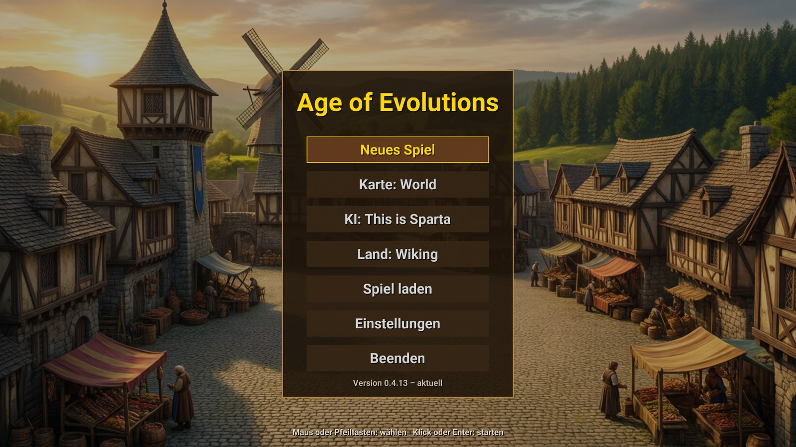
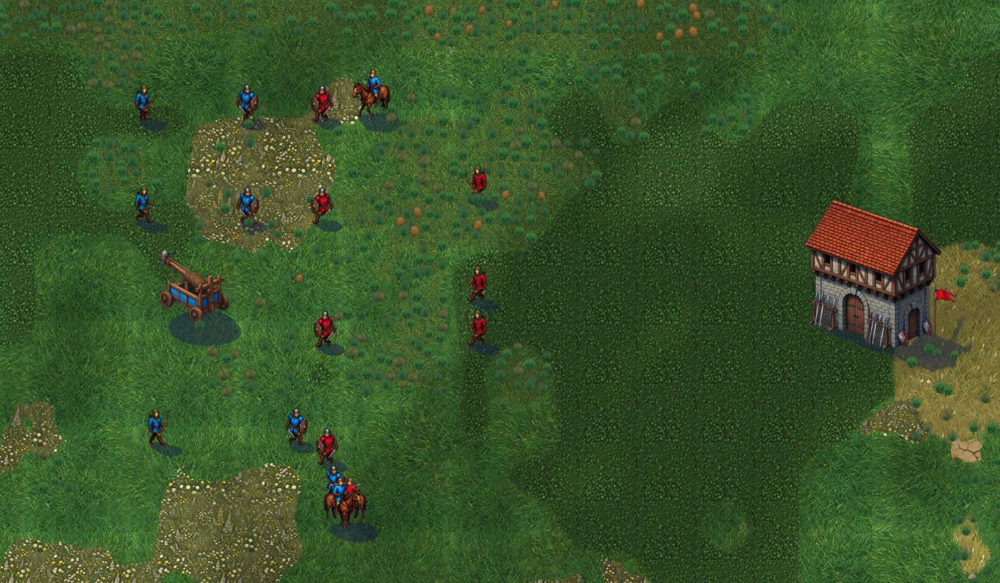
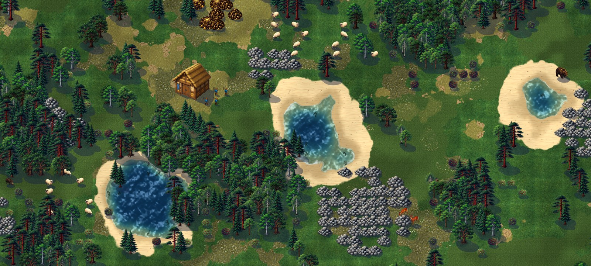
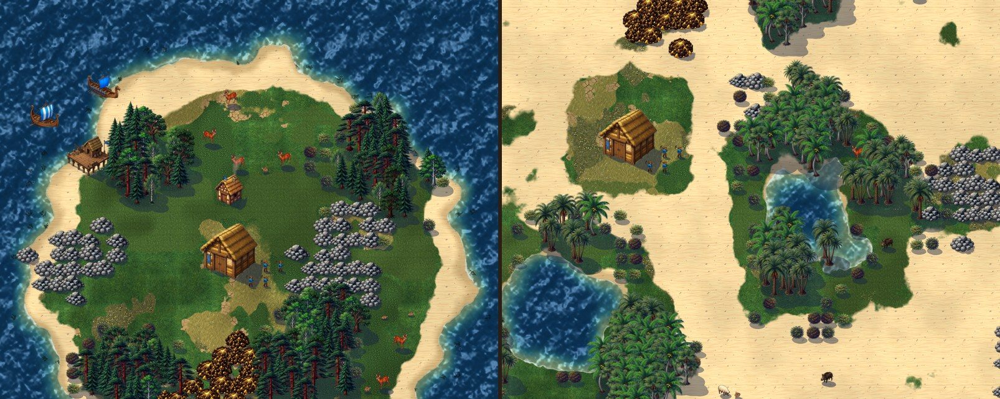
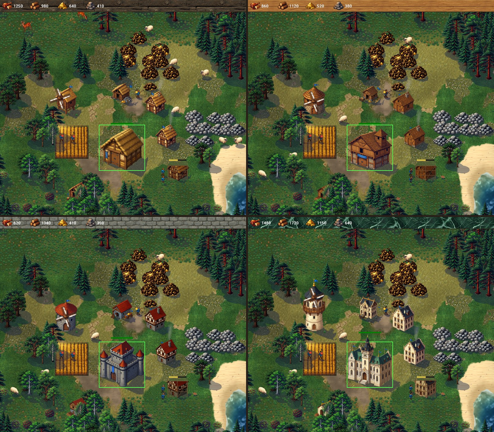
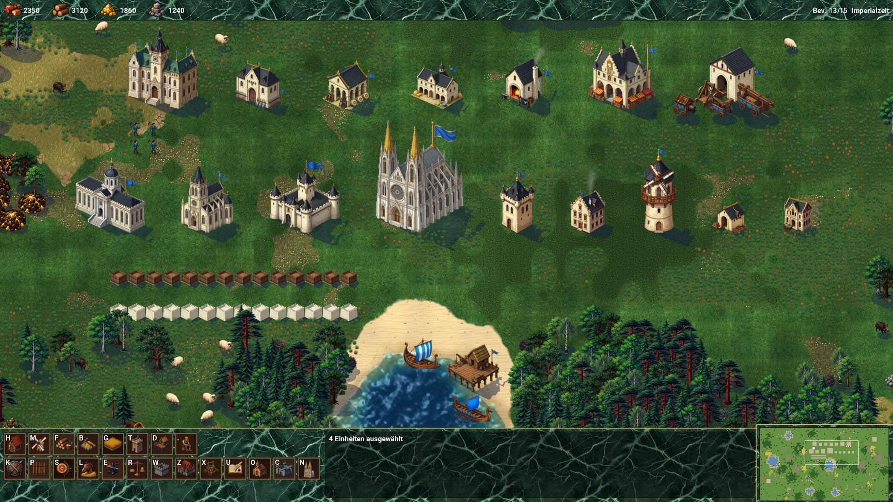

# Age of Evolutions

Ein Age-of-Empires-I-artiges Echtzeitstrategiespiel, implementiert in C# mit MonoGame unter .NET 10.



*Das Hauptmenü: direkt unter „Neues Spiel“ stehen Kartengröße, Stufe des Computergegners und das
Land (Europa, Ägypten, Wiking); unten zeigt es die Version und ob ein Update bereitliegt.*


*In der Dunklen Zeit ist das Stadtzentrum ein strohgedecktes Langhaus, hier ausgewählt: grüner Rahmen,
Lebensbalken und unten in der Leiste sein Status - es bildet gerade Dorfbewohner aus, einer wartet
noch. Zwei Dorfbewohner ernten das Feld an der Mühle, zwei bauen ein weiteres Haus, andere fällen
Holz und schürfen Gold an den Lagern; Schafe ziehen über die Wiese, am See liegt ein Sandstrand, am
Waldrand streifen ein Wildschwein und ein Wolf. Jedes Gebäude, jeder Baum und jede Figur wirft seinen
Schatten in seiner eigenen Form, alle in dieselbe Richtung.*



*Ein Gefecht in der Ritterzeit, für die Aufnahme aufgestellt, blau gegen rot: die blaue Armee ist in
Aufstellung marschiert - Nahkämpfer vorn, Bogenschützen dahinter, das Katapult hinten, die Späher an
den Flanken. Die rote Miliz stürmt in die Reihe, an beiden Flanken treffen die Reiter aufeinander,
dahinter warten die roten Bogenschützen vor ihrer Kaserne. Nahkämpfer halten einen halben Schritt
Abstand zum Gegner und blicken ihn an; wer getroffen wird, wehrt sich von selbst.*



*Ein Kartenausschnitt, für die Aufnahme ohne Nebel: das Stadtzentrum mit den ersten Dorfbewohnern,
Goldadern, eine Schafherde, Steinbrüche, Wald, drei Seen mit Strand - am rechten steht ein Bär - und
dazwischen die Wiese aus kurzem, hohem und trockenem Gras, Klee und Blumen.*



*Die beiden anderen Länder, ebenfalls ohne Nebel: links **Wiking** - das Dorf auf seiner Insel mit
Wald, Steinbrüchen, Gold und Rehen, am Ufer der Hafen mit Transport- und Kriegsschiff; rechts
**Ägypten** - Wüste mit Grasbüscheln, das Dorf auf einem grünen Fleck im Sand, daneben zwei Oasen
mit Palmen.*



*Dieselbe Siedlung in allen vier Zeitaltern: Gebäude, Kleidung der Dorfbewohner und die Leiste
wechseln mit dem Aufstieg — vom Langhaus mit Strohdach über Holzbau und Burg bis zum Rathaus aus
hellem Haustein, die Leiste von dunklem Holz über helles Holz und Mauerwerk bis Marmor.*



*In der Imperialzeit steht jedes Gebäude bereit - oben Stadtzentrum, Kaserne, Schießstand, Stall,
Schmiede, Markt und die Belagerungswerkstatt mit Rammbock, Katapult und Tribok davor; darunter
Universität, Kloster, Burg, das Wunder, Wachturm, Haus, Mühle, Holzfäller- und Bergbaulager. Davor
je eine Mauer aus Palisaden und aus Stein, am See der Hafen mit Transport- und Kriegsschiff. Mit
ausgewählten Dorfbewohnern zeigt die Leiste beide Tastenreihen.*

## Spielstand

Spielbar sind Wirtschaft, Aufstieg durch die Zeitalter und Kampf gegen einen Computergegner:

- Dorfbewohner sammeln Nahrung, Holz, Gold und Stein und liefern selbstständig ab
- Bauen: Haus, Mühle, Holzfällerlager, Bergbaulager, Farm, Kaserne und Palisadenmauer; ab der
  Feudalzeit Wachturm, Schießstand, Stall, Schmiede, Markt und Steinmauer; ab der Ritterzeit ein
  weiteres Stadtzentrum, Belagerungswerkstatt, Universität, Kloster und Burg; in der Imperialzeit
  das Wunder. Mauern setzt man Stück für Stück in einer Reihe. Fehlen Rohstoffe, nennt das Spiel,
  welche und wie viele
- Ausbildung im ausgewählten Gebäude: Dorfbewohner im Stadtzentrum, Miliz in der Kaserne, ab der
  Feudalzeit Bogenschützen im Schießstand und Späher im Stall. Die Bevölkerungsgrenze ergibt sich
  aus den Gebäuden
- Forschungen: Webstuhl im Stadtzentrum, Pferdekummet in der Mühle, Doppelaxt im Holzfällerlager,
  Goldbergbau im Bergbaulager, Schmiedekunst, Befiederte Pfeile und Schuppenpanzer in der Schmiede,
  Maurerkunst in der Universität
- Markt (ab der Feudalzeit): Nahrung, Holz und Stein je 100 gegen Gold kaufen und verkaufen, mit
  Shift 500. Der Kurs gilt für beide Spieler, wird mit jedem Handel in dieselbe Richtung
  ungünstiger und erholt sich ohne Handel langsam; die Leiste nennt ihn. Auch der Computergegner
  baut einen Markt und tauscht, wenn ihm Gold, Nahrung oder Holz ausgeht
- Zeitalter: Feudal-, Ritter- und Imperialzeit, je mit Kosten und Forschungszeit; Gebäude,
  Dorfbewohner und Leisten sehen in jedem Zeitalter anders aus
- Kampf: ein Linksklick auf einen Gegner oder ein fremdes Gebäude schickt die Auswahl hin. Nahkämpfer
  halten einen halben Schritt Abstand und blicken zum Gegner, Bogenschützen schießen aus vier Kacheln
  Entfernung. Getroffene Soldaten wehren sich von selbst, und wer seinen Gegner besiegt hat, greift
  den nächsten in der Nähe an. Dorfbewohner sind keine Krieger: getroffen fliehen sie sechs Kacheln
  vom Angreifer weg und nehmen ihre Arbeit von selbst wieder auf - dasselbe Feld, denselben Baum,
  dieselbe Baustelle -, sobald der Angreifer tot ist oder abgezogen; auf Befehl kämpfen sie trotzdem.
  Mehrere Soldaten laufen in Aufstellung: der Klick ist ihre Mitte, Nahkämpfer stehen vorn,
  Bogenschützen und Belagerung dahinter, Reiter an den Flanken, eine Kachel frei zwischen Nachbarn,
  Blick in Marschrichtung; die Schnellen gehen im Takt der Langsamen, alle kommen zugleich an.
  Dorfbewohner verteilen sich um den Zielpunkt. Auch Gebäude nehmen Schaden und lassen sich
  zerstören
- Computergegner: eine eingebaute KI spielt die Gegenseite. Sie wirtschaftet, baut Lager an den
  Rohstoffen, schickt einen Kundschafter aus, steigt auf, bildet Soldaten aus, greift in Wellen an
  und verteidigt ihr Dorf. Wird die eigene Seite getroffen, glüht die obere Leiste rot und ein
  Warnton erklingt. Drei Stufen (Hauptmenü, Eintrag „KI“ unter der Karte): **Defense** greift nie selbst an,
  baut zwei Wachtürme und hält Nahkämpfer und Bogenschützen in Aufstellung vor dem Dorf; **Normal**
  greift in Wellen an; **This is Sparta** zieht in Aufstellung los - Nahkämpfer vorn, Bogenschützen
  dahinter, je eine Kachel Abstand -, Reiter greifen im Schwall an und ziehen sich hinter den Verband
  zurück. Wie sie im Vergleich zum Original arbeitet, steht in
  [Der Computergegner](docs/AoE-Computergegner.md)
- Wilde Tiere: Schafe, Rehe, Kaninchen und Wildschweine zum Jagen, dazu Bären und Wolfsrudel.
  Rehe laufen vor näherenden Einheiten davon und müssen mit einem Angriff erlegt werden; ein
  getroffenes Wildschwein wehrt sich und jagt seinen Angreifer 6 s lang bis zu 8 Kacheln - so lockt
  man es in das Dorf. Ein einzelner Wolf oder ein einzelnes Wildschwein richtet an Dorfbewohnern nur
  halb so viel Schaden an wie diese an ihm - vier oder mehr können einen besiegen, Soldaten und Bären
  bleiben davon unberührt. Von Gebäuden halten Raubtiere fünf Kacheln Abstand und ziehen sich vor
  neuen zurück. Getroffene Soldaten wehren sich, ein Klick setzt die Auswahl auf ein Raubtier an -
  Bogenschützen schießen aus sicherer Entfernung. Ein erlegtes Tier liefert Fleisch, das in drei
  sichtbaren Stufen verdirbt; die Jäger zerlegen einen Bären gleich. Bären und Wölfe laufen in acht
  Phasen und greifen in acht an: der Wolf duckt sich, springt und beißt zu, der Bär richtet sich auf
  und schlägt mit der Pranke - der Biss trifft genau mit dem Schaden
  ([Zeitlupe](docs/bilder/raubtiere.gif))
- Niederlage: wer weder Dorfbewohner noch Stadtzentrum hat, verliert; ein Endbildschirm nennt den
  Sieger
- Geräusche: Axt, Spitzhacke, Hacke, Sichel und Hammer klingen im Takt der Arbeit, dazu Schwerter,
  Bogen, Treffer, Tod und einstürzende Gebäude. Zu hören ist nur, was man sieht - im Bild voll,
  daneben ausklingend, links und rechts nach der Lage auf dem Bildschirm
- Nebel des Krieges, Minimap, Zoom und Kamera; ein Klick ins Schwarze wirkt immer - die Wegsuche
  plant nur mit dem, was der Spieler schon gesehen hat
- Lebendige Landschaft: weiche Ufer und Sandstrände, Wasser mit Tiefe, Wellen, Schaum und
  Fischschwärmen; eine Wiese aus fünf Grassorten von kurzem Klee bis hüfthohem Gras, dazu Blumen
  und ausgedörrte Erde, im hohen Gras stecken die Figuren bis zur Hüfte; Beerenbüsche und
  Trampelpfade, wo oft jemand läuft; Weizen und Bäume wiegen sich in denselben Windböen; Waldkacheln
  tragen zwei Bäume, die beim Hacken nacheinander in fünf Stufen fallen - stehend, umgefallen mit
  Krone, zwei Stämme, ein Stamm, Stock
- Dorfbewohner, Soldaten, Schafe und Wild gehen natürlich: Schritte nach der gelaufenen Strecke,
  Anfahren und Abbremsen, gerade Wege über freies Land, Blick in Laufrichtung und zur Arbeit; die
  Miliz holt zum Schwertschlag aus, der Späher stößt mit dem Speer
- Drei Kartengrößen, im Hauptmenü wählbar: Standard (90×90), Kontinent (128×128) und
  World (181×181, die doppelte Fläche einer Kontinent-Karte); die Karte nimmt das
  Seitenverhältnis des Fensters an. Direkt darunter wählt der Eintrag „Land" den Kartentyp:
  **Europa** wie bisher, **Ägypten** als Wüste mit Oasen (Seen ohne Fische, 50 % mehr Schafe,
  grüne Ufer rund um das Wasser) und Palmen am Wasser, und **Wiking** als Inselgruppe, auf der die
  Startpositionen auf verschiedenen Inseln stehen und nur Schiffe hinüberbringen. Noch darunter
  wählt der Eintrag „KI“ die Stufe des Computergegners (Defense, Normal, This is Sparta); alles
  bleibt gespeichert
- Schiffe (Hafen, Wiking-Karte): Der Hafen bildet Transportschiffe (bis zu fünf Einheiten, 100 HP)
  und Kriegsschiffe (120 HP) aus; Schiffe fahren nur auf Wasser. Eine oder mehrere Dorfbewohner
  (oder andere Landeinheiten) auswählen und aufs eigene Transportschiff klicken - sie laufen ans
  Wasser und steigen ein, statt das Schiff auszuwählen; auswählen lässt es sich mit dem Linksklick
  nur, solange keine Landeinheit ausgewählt ist. Das Schiff wartet an
  der Stelle, an der die meisten Einheiten warten; eine Einheit ohne erreichbare Anlegestelle
  behält ihren Auftrag, und die Leiste meldet es. Die KI-Armee überquert die Inseln ebenfalls mit
  Schiffen: die Welle setzt in Gruppen zu je fünf über, sammelt sich am Brückenkopf und marschiert
  weiter mit denen, die drüben sind
- Belagerung: die Belagerungswerkstatt bildet ab der Ritterzeit Rammbock (160 Holz, 75 Gold,
  36 s) und Katapult (160 Holz, 135 Gold, 46 s) aus, ab der Imperialzeit den Tribok (200 Holz,
  200 Gold, 50 s), den auch die Burg baut. Die Geräte rollen über die Karte, der Tribok abgebaut
  auf seinem Karren; im Angriff stößt der Rammbalken genau beim Treffer zu, Katapult und Tribok
  schleudern Steine im hohen Bogen, die beim Treffer einschlagen und auch Gegner bis eine Kachel
  daneben mit halbem Schaden treffen. Das Katapult wirft erst ab drei Kacheln und weicht zurück,
  wenn ein Gegner näher kommt; der Tribok schießt nur auf Gebäude und muss dafür aufgebaut werden
  (`S`, 4 s, Abbauen 2 s); der Rammbock richtet gegen Einheiten fast nichts aus. Rammbock und
  Katapult belegen zwei Plätze der Bevölkerung, der Tribok drei. Beschädigte Geräte reparieren
  Dorfbewohner per Klick
- Spielstände: mehrere Plätze (Spielstand 1, 2, 3, …), im Hauptmenü laden, im Pausenmenü
  speichern oder überschreiben; einen Platz löscht man in der Liste mit der Löschtaste
  (Entf, am Gamepad Y) — einmal Ja/Nein bestätigen, und der Platz ist weg,
  die Nummer wird beim nächsten Speichern wieder frei

Noch nicht da sind Handelskarren, Einheiten aus dem Kloster und die Einzigartigen der Burg, siehe
[TODO](TODO.md).

## Steuerung

| Eingabe | Wirkung |
|---|---|
| Rechtsklick, Rahmen mit der rechten Taste | Einheiten auswählen |
| Linksklick | Befehl: hingehen (mehrere Soldaten in Aufstellung um den Klick), sammeln, bauen, angreifen; mit Landeinheiten in der Auswahl auf ein eigenes Transportschiff: einsteigen; auf eine eigene Einheit: auswählen; ohne Auswahl auf ein Gebäude: das Gebäude auswählen |
| Linke Taste gedrückt ziehen | Karte verschieben |
| Mausrad, `+` / `-` | Zoomen |
| Pfeiltasten, Bildrand | Kamera schwenken |
| Klick in die Minimap | Kamera dorthin |
| `Q` | Im ausgewählten Gebäude ausbilden oder forschen; ohne Auswahl Dorfbewohner im Stadtzentrum |
| `W` `E` | Weitere Forschungen: Webstuhl im Stadtzentrum, Befiederte Pfeile und Schuppenpanzer in der Schmiede; in der Belagerungswerkstatt Katapult und Tribok (`Q` Rammbock, in der Burg `Q` Tribok) |
| `A` | Aufstieg ins nächste Zeitalter |
| `S` | Mit Triboks in der Auswahl: aufbauen bzw. abbauen (sonst Schießstand bauen) |
| `Q` `W` `E` / `Y` `X` `C` | Am ausgewählten Markt: 100 Nahrung, Holz, Stein kaufen / verkaufen, mit `Shift` 500 |
| `H` `M` `F` `B` `G` `T` | Haus, Mühle, Holzfällerlager, Bergbaulager, Farm, Wachturm |
| `K` `P` `S` `L` `E` `R` `W` | Zweite Tastenreihe: Kaserne, Palisadenmauer, Schießstand, Stall, Schmiede, Markt, Steinmauer |
| `Z` `X` `U` `O` `C` `N` | Stadtzentrum, Belagerungswerkstatt, Universität, Kloster, Burg, Wunder |
| `.` | Nächster untätiger Dorfbewohner |
| `Esc` | Pause und Menü |

Die Befehlstasten in der unteren Leiste tun dasselbe; zeigt die Maus auf eine Taste,
nennt die Leiste Name und Kosten. Ist ein Gebäude ausgewählt, gehören die Buchstaben seinen
Ausbildungs- und Forschungstasten; Bautasten gibt es nur ohne ausgewähltes Gebäude und nur für
Gebäude, die das Zeitalter schon freischaltet. Nach einem Mauerstück bleibt der Setzmodus an, bis
man die Taste noch einmal drückt; ein Rechtsklick bricht das Setzen ab.

## Projektstruktur

- **src/AoE.Core**: MonoGame-unabhängige Spiellogik (Kampf, Wirtschaft, Forschung, Zeitalter,
  Karte, Wegfindung, KI)
- **AgeOfEvolutions/**: MonoGame-Spiel mit den Plattformprojekten DesktopGL und WindowsDX
- **tests/AoE.Tests**: Unit-Tests
- **demo/**: Kleine Konsolen-Testapp
- **docs/**: Dokumentation
- **tools/**: Hilfswerkzeuge — Prüfprogramme für Karte (`kartenpruefung`), Spielablauf
  (`spielablauf`) und KI (`ai-pruefung`), der Harness für lokale Ollama-Agents, `tools/bilder`
  für die Spielgrafik und `tools/klang` für die Geräusche

## Zielplattformen

- **DesktopGL**: Plattformübergreifender Pfad für Windows, macOS und Linux
- **WindowsDX**: Zusätzliche reine Windows-Variante
- Android und iOS werden nicht unterstützt (die entsprechenden Projekte der MonoGame-Vorlage wurden am 2026-09-23 entfernt)

## Herunterladen und Starten

Fertige Pakete für Windows, macOS (Apple Silicon `osx-arm64`, Intel `osx-x64`) und Linux liegen unter
[Releases](https://github.com/gyurasan/AoE-Game/releases); .NET muss dafür nicht installiert sein.
Ist eine neuere Version erschienen, bietet das Hauptmenü sie unter „Update“ an und ersetzt die
Installation an Ort und Stelle.

### Windows

Für Windows gibt es dasselbe Spiel in zwei Fassungen:

| Paket | Grafik |
|---|---|
| `AoE_Evolutions_<Version>_win-x64-desktopgl.zip` | OpenGL - dieselbe Fassung wie auf macOS und Linux |
| `AoE_Evolutions_<Version>_win-x64-windowsdx.zip` | DirectX 11 - falls OpenGL auf dem Rechner Probleme macht |

Zip entpacken und im Ordner `win-x64-desktopgl` (bzw. `win-x64-windowsdx`) `AgeOfEvolutions.exe`
starten. Das Spiel ist nicht signiert, deshalb hält Windows SmartScreen den ersten Start an („Der
Computer wurde durch Windows geschützt“): auf „Weitere Informationen“ klicken, dann auf „Trotzdem
ausführen“. Wer das vermeiden will, nimmt der Zip vor dem Entpacken in PowerShell die
Download-Markierung:

```powershell
Unblock-File "$HOME\Downloads\AoE_Evolutions_*_win-x64-desktopgl.zip"
```

### macOS

Auf einem anderen Mac blockiert macOS das heruntergeladene Spiel zunächst, weil es nicht signiert
ist, und meldet, es sei beschädigt oder könne nicht geöffnet werden. Nach dem Entpacken deshalb
einmal im Terminal die Quarantäne-Markierung vom ganzen Ordner entfernen, dann starten:

```bash
xattr -cr ~/Downloads/osx-arm64
cd ~/Downloads/osx-arm64 && ./AgeOfEvolutions
```

Liegt der Ordner woanders, den Pfad anpassen - oder den Ordner ins Terminal ziehen. Wer im Terminal
mit `unzip` statt im Finder entpackt, muss das Programm zusätzlich ausführbar machen:
`chmod +x osx-arm64/AgeOfEvolutions`.

## Bauen und Starten

```bash
dotnet build AgeOfEvolutions/AgeOfEvolutions.DesktopGL/AgeOfEvolutions.DesktopGL.csproj
dotnet run --project AgeOfEvolutions/AgeOfEvolutions.DesktopGL
```

Ohne Menü direkt ins Spiel:

```bash
dotnet run --project AgeOfEvolutions/AgeOfEvolutions.DesktopGL -- --rts
```

Weitere Schalter, zusammen mit `--rts`:

| Schalter | Wirkung |
|---|---|
| `--karte standard` / `kontinent` / `world` | Die Kartengröße für `--rts` |
| `--both` | Beide Seiten spielt die KI, KI gegen KI |
| `--test` | Ganze Karte ohne Nebel, Gegner rot auf der Minimap |
| `--api [port]` | Lokale HTTP-Schnittstelle für eine externe KI (Standard 8080) |

## Tests

```bash
dotnet test tests/AoE.Tests/AoE.Tests.csproj
```

Die Prüfprogramme lassen das Spiel ohne Grafik laufen:

```bash
dotnet run --project tools/spielablauf -- angriff soldaten forschung   # Abläufe nach Gruppen
dotnet run --project tools/ai-pruefung                                # KI gegen KI: Wirtschaft, Erkunden, Angriff
dotnet run --project tools/kartenpruefung -- wild rohstoffe start    # Kartengenerierung, 50 Karten
```

## Grafik und Klang

Programmsymbol, Menübild, Tastensymbole, Leisten, Rohstoffsymbole, Gebäude, Dorfbewohner und
Soldaten je Zeitalter, Boden, Gras, Felder, Bäume, Beerenbüsche, Stein, Gold, Schafe, Rehe,
Kaninchen, Wildschweine, Bären und Wölfe sind mit Qwen-Image erzeugt, lokal über ComfyUI. Prompts,
Seeds und die Werkzeuge dafür liegen in `tools/bilder`, jedes Bild lässt sich damit genau so wieder
erzeugen; Einzelheiten in der [Projektstruktur](docs/PROJEKT_STRUKTUR.md#grafik). Gras, Sand und
Wasser setzt ein Shader (`Content/Effects/Boden.fx`) aus diesen Bildern zusammen - das Gras aus fünf
Sorten, die er nach Halmhöhe ineinander blendet, der Weizen wiegt sich in
`Content/Effects/Weizen.fx`; Gehen, Schlagen, Wind und Fische rechnet das Spiel selbst.

Die Geräusche sind echte Aufnahmen von [Freesound](https://freesound.org), alle unter CC0
(gemeinfrei): eine Axt im Stamm eines Baums, eine Spitzhacke auf Stein, ein Hammer auf Nagel und
Brett, Schwerter, eine Bogensehne, ein einstürzendes Holzhaus. `tools/klang/klang.py` lädt sie,
schneidet je Geräusch drei Einzelschläge heraus und gleicht die Lautstärke an; Urheber und Schnitte
stehen dort, Einzelheiten in der [Projektstruktur](docs/PROJEKT_STRUKTUR.md#geräusche).

## Dokumentation

- [Spielspezifikation](docs/AgeOfEmpires.md)
- [Der Computergegner in Age of Empires](docs/AoE-Computergegner.md) — und wie unsere KI dazu steht
- [Projektstruktur](docs/PROJEKT_STRUKTUR.md)
- [TODO](TODO.md)
