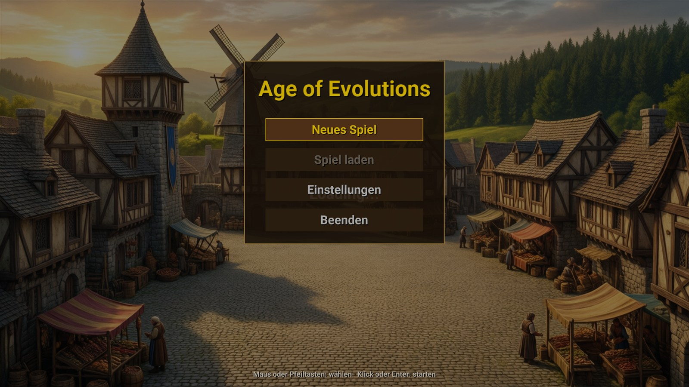
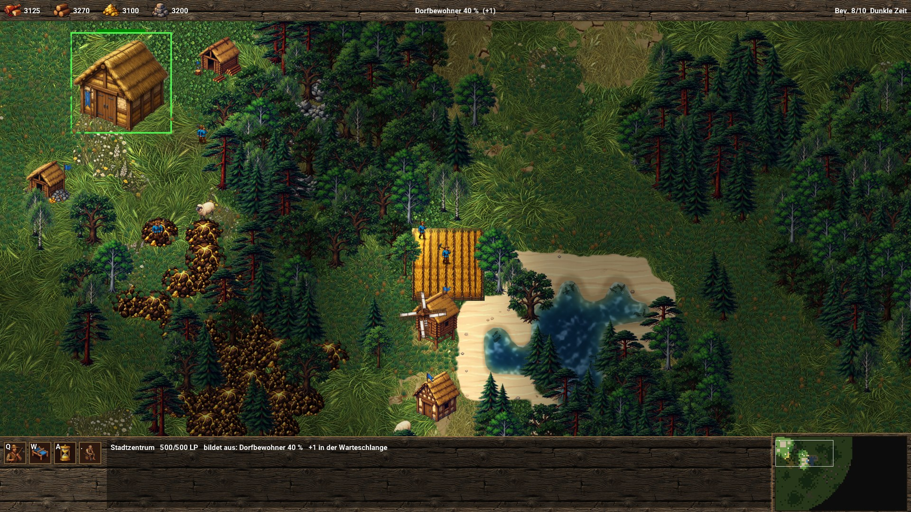
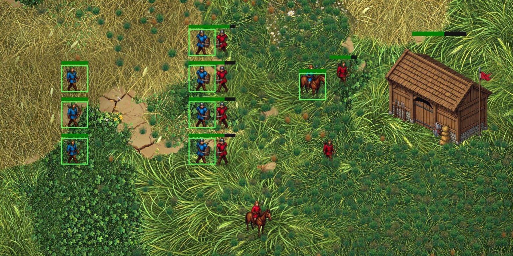
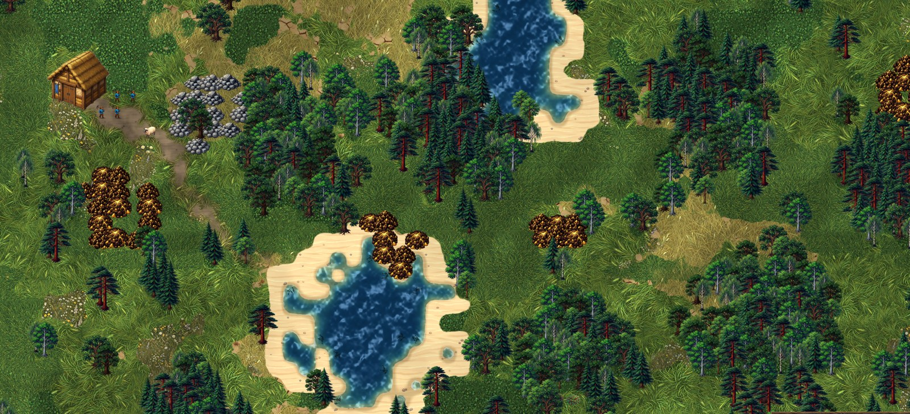
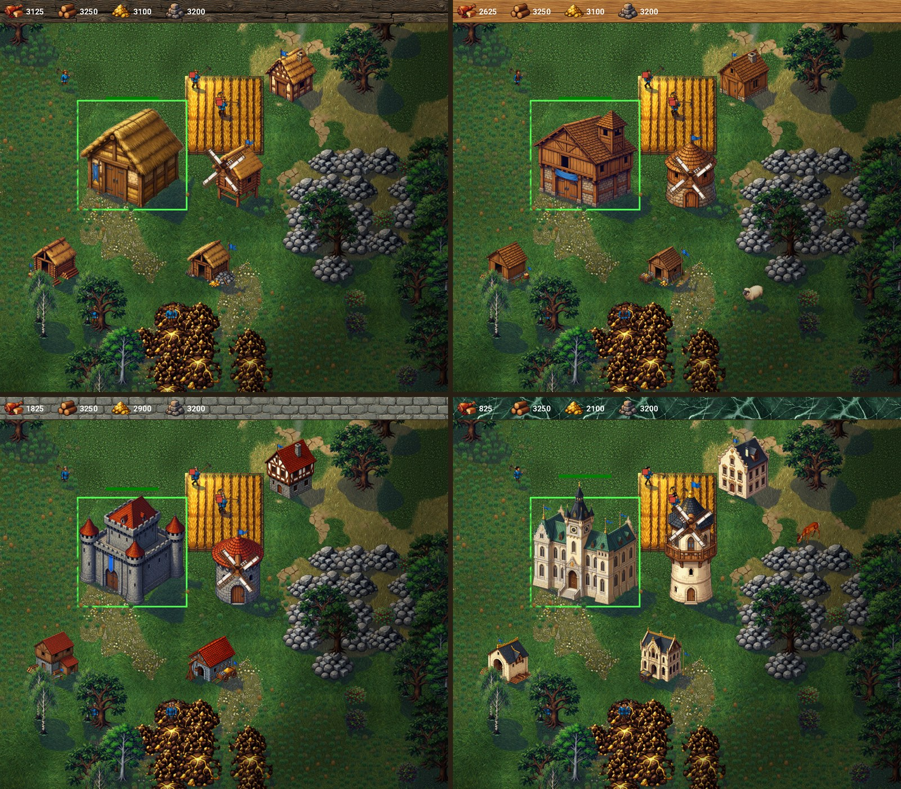
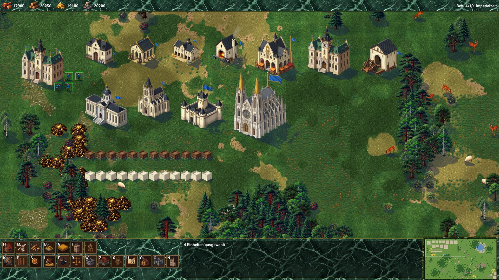

# Age of Evolutions

Ein Age-of-Empires-I-artiges Echtzeitstrategiespiel, implementiert in C# mit MonoGame unter .NET 10.





*In der Dunklen Zeit ist das Stadtzentrum ein strohgedecktes Langhaus, hier ausgewählt: grüner Rahmen,
Lebensbalken und unten in der Leiste sein Status - es bildet gerade Dorfbewohner aus, einer wartet
noch. Zwei Dorfbewohner ernten das Feld an der Mühle, andere fällen Holz und schürfen Gold an den
Lagern; Schafe ziehen über die Wiese, am See liegt ein Sandstrand.*



*Ein Gefecht in der Feudalzeit, für die Aufnahme aufgestellt, blau gegen rot: die ausgewählte Miliz
hält einen halben Schritt Abstand zum Gegner und blickt ihn an, die Bogenschützen schießen aus der
zweiten Reihe, der Späher reitet einen gegnerischen Bogenschützen an. Wer getroffen wird, wehrt sich
von selbst; die Balken zeigen die Lebenspunkte, auch die der angeschlagenen Kaserne.*



*Ein Kartenausschnitt, für die Aufnahme ohne Nebel: das Stadtzentrum, davor ein Trampelpfad am
Steinbruch vorbei, Wald, zwei Seen mit Strand, Goldadern und dazwischen die Wiese aus kurzem, hohem und
trockenem Gras, Klee und Blumen.*



*Dieselbe Siedlung in allen vier Zeitaltern: Gebäude, Kleidung der Dorfbewohner und die Leiste
wechseln mit dem Aufstieg — vom Langhaus mit Strohdach über Holzbau und Burg bis zum Rathaus aus
hellem Haustein, die Leiste von dunklem Holz über helles Holz und Mauerwerk bis Marmor.*



*In der Imperialzeit steht jedes Gebäude bereit: Stadtzentrum, Kaserne, Schießstand, Stall,
Schmiede, Markt, ein weiteres Stadtzentrum, Belagerungswerkstatt, Universität, Kloster, Burg und das
Wunder, davor je eine Mauer aus Palisaden und aus Stein. Mit ausgewählten Dorfbewohnern zeigt die
Leiste beide Tastenreihen.*

## Spielstand

Spielbar sind Wirtschaft, Aufstieg durch die Zeitalter und Kampf gegen einen Computergegner:

- Dorfbewohner sammeln Nahrung, Holz, Gold und Stein und liefern selbstständig ab
- Bauen: Haus, Mühle, Holzfällerlager, Bergbaulager, Farm, Kaserne und Palisadenmauer; ab der
  Feudalzeit Wachturm, Schießstand, Stall, Schmiede, Markt und Steinmauer; ab der Ritterzeit ein
  weiteres Stadtzentrum, Belagerungswerkstatt, Universität, Kloster und Burg; in der Imperialzeit
  das Wunder. Mauern setzt man Stück für Stück in einer Reihe. Fehlen Rohstoffe, nennt das Spiel,
  welche und wie viele
- Ausbildung im ausgewählten Gebäude: Dorfbewohner im Stadtzentrum, Miliz in der Kaserne, ab der
  Feudalzeit Bogenschützen im Schießstand und Späher im Stall. Die Bevölkerungsgrenze ergibt sich
  aus den Gebäuden
- Forschungen: Webstuhl im Stadtzentrum, Pferdekummet in der Mühle, Doppelaxt im Holzfällerlager,
  Goldbergbau im Bergbaulager, Schmiedekunst, Befiederte Pfeile und Schuppenpanzer in der Schmiede,
  Maurerkunst in der Universität
- Zeitalter: Feudal-, Ritter- und Imperialzeit, je mit Kosten und Forschungszeit; Gebäude,
  Dorfbewohner und Leisten sehen in jedem Zeitalter anders aus
- Kampf: ein Linksklick auf einen Gegner oder ein fremdes Gebäude schickt die Auswahl hin. Nahkämpfer
  halten einen halben Schritt Abstand und blicken zum Gegner, Bogenschützen schießen aus vier Kacheln
  Entfernung. Wer getroffen wird, wehrt sich von selbst - Soldaten wie Dorfbewohner -, und wer
  seinen Gegner besiegt hat, greift den nächsten in der Nähe an. Mehrere Einheiten verteilen sich um
  einen Zielpunkt, statt sich auf ihm zu stapeln. Auch Gebäude nehmen Schaden und lassen sich
  zerstören
- Computergegner: eine eingebaute KI spielt die Gegenseite. Sie wirtschaftet, baut Lager an den
  Rohstoffen, schickt einen Kundschafter aus, steigt auf, bildet Soldaten aus, greift in Wellen an
  und verteidigt ihr Dorf. Wird die eigene Seite getroffen, glüht die obere Leiste rot und ein
  Warnton erklingt. Wie sie im Vergleich zum Original arbeitet, steht in
  [Der Computergegner](docs/AoE-Computergegner.md)
- Niederlage: wer weder Dorfbewohner noch Stadtzentrum hat, verliert; ein Endbildschirm nennt den
  Sieger
- Geräusche: Axt, Spitzhacke, Hacke, Sichel und Hammer klingen im Takt der Arbeit, dazu Schwerter,
  Bogen, Treffer, Tod und einstürzende Gebäude. Zu hören ist nur, was man sieht - im Bild voll,
  daneben ausklingend, links und rechts nach der Lage auf dem Bildschirm
- Nebel des Krieges, Minimap, Zoom und Kamera; ein Klick ins Schwarze wirkt immer - die Wegsuche
  plant nur mit dem, was der Spieler schon gesehen hat
- Lebendige Landschaft: weiche Ufer und Sandstrände, Wasser mit Tiefe, Wellen, Schaum und
  Fischschwärmen; eine Wiese aus fünf Grassorten von kurzem Klee bis hüfthohem Gras, dazu Blumen
  und ausgedörrte Erde, im hohen Gras stecken die Figuren bis zur Hüfte; Beerenbüsche und
  Trampelpfade, wo oft jemand läuft; Weizen und Bäume wiegen sich in denselben Windböen
- Dorfbewohner, Soldaten, Schafe und Wild gehen natürlich: Schritte nach der gelaufenen Strecke,
  Anfahren und Abbremsen, gerade Wege über freies Land, Blick in Laufrichtung und zur Arbeit; die
  Miliz holt zum Schwertschlag aus, der Späher stößt mit dem Speer
- Drei Kartengrößen, im Hauptmenü wählbar: Standard, Groß und Maximal; die Karte nimmt das
  Seitenverhältnis des Fensters an

Noch nicht da sind Handel, Einheiten aus Belagerungswerkstatt, Kloster und Burg, schießende Türme
und Schwierigkeitsgrade für die KI, siehe [TODO](TODO.md).

## Steuerung

| Eingabe | Wirkung |
|---|---|
| Rechtsklick, Rahmen mit der rechten Taste | Einheiten auswählen |
| Linksklick | Befehl: hingehen, sammeln, bauen, angreifen; auf eine eigene Einheit: auswählen; ohne Auswahl auf ein Gebäude: das Gebäude auswählen |
| Linke Taste gedrückt ziehen | Karte verschieben |
| Mausrad, `+` / `-` | Zoomen |
| Pfeiltasten, Bildrand | Kamera schwenken |
| Klick in die Minimap | Kamera dorthin |
| `Q` | Im ausgewählten Gebäude ausbilden oder forschen; ohne Auswahl Dorfbewohner im Stadtzentrum |
| `W` `E` | Weitere Forschungen: Webstuhl im Stadtzentrum, Befiederte Pfeile und Schuppenpanzer in der Schmiede |
| `A` | Aufstieg ins nächste Zeitalter |
| `H` `M` `F` `B` `G` `T` | Haus, Mühle, Holzfällerlager, Bergbaulager, Farm, Wachturm |
| `K` `P` `S` `L` `E` `R` `W` | Zweite Tastenreihe: Kaserne, Palisadenmauer, Schießstand, Stall, Schmiede, Markt, Steinmauer |
| `Z` `X` `U` `O` `C` `N` | Stadtzentrum, Belagerungswerkstatt, Universität, Kloster, Burg, Wunder |
| `.` | Nächster untätiger Dorfbewohner |
| `Esc` | Pause und Menü |

Die Befehlstasten in der unteren Leiste tun dasselbe; zeigt die Maus auf eine Taste,
nennt die Leiste Name und Kosten. Ist ein Gebäude ausgewählt, gehören die Buchstaben seinen
Ausbildungs- und Forschungstasten; Bautasten gibt es nur ohne ausgewähltes Gebäude und nur für
Gebäude, die das Zeitalter schon freischaltet. Nach einem Mauerstück bleibt der Setzmodus an, bis
man die Taste noch einmal drückt; ein Rechtsklick bricht das Setzen ab.

## Projektstruktur

- **src/AoE.Core**: MonoGame-unabhängige Spiellogik (Kampf, Wirtschaft, Forschung, Zeitalter,
  Karte, Wegfindung, KI)
- **AgeOfEvolutions/**: MonoGame-Spiel mit den Plattformprojekten DesktopGL und WindowsDX
- **tests/AoE.Tests**: Unit-Tests
- **demo/**: Kleine Konsolen-Testapp
- **docs/**: Dokumentation
- **tools/**: Hilfswerkzeuge — Prüfprogramme für Karte (`kartenpruefung`), Spielablauf
  (`spielablauf`) und KI (`ai-pruefung`), der Harness für lokale Ollama-Agents, `tools/bilder`
  für die Spielgrafik und `tools/klang` für die Geräusche

## Zielplattformen

- **DesktopGL**: Plattformübergreifender Pfad für Windows, macOS und Linux
- **WindowsDX**: Zusätzliche reine Windows-Variante
- Android und iOS werden nicht unterstützt (die entsprechenden Projekte der MonoGame-Vorlage wurden am 2026-09-23 entfernt)

## Bauen und Starten

```bash
dotnet build AgeOfEvolutions/AgeOfEvolutions.DesktopGL/AgeOfEvolutions.DesktopGL.csproj
dotnet run --project AgeOfEvolutions/AgeOfEvolutions.DesktopGL
```

Ohne Menü direkt ins Spiel:

```bash
dotnet run --project AgeOfEvolutions/AgeOfEvolutions.DesktopGL -- --rts
```

Weitere Schalter, zusammen mit `--rts`:

| Schalter | Wirkung |
|---|---|
| `--karte gross`, `--karte max` | Große bzw. maximale Karte |
| `--both` | Beide Seiten spielt die KI, KI gegen KI |
| `--test` | Ganze Karte ohne Nebel, Gegner rot auf der Minimap |
| `--api [port]` | Lokale HTTP-Schnittstelle für eine externe KI (Standard 8080) |

## Tests

```bash
dotnet test tests/AoE.Tests/AoE.Tests.csproj
```

Die Prüfprogramme lassen das Spiel ohne Grafik laufen:

```bash
dotnet run --project tools/spielablauf -- angriff soldaten forschung   # Abläufe nach Gruppen
dotnet run --project tools/ai-pruefung                                # KI gegen KI: Wirtschaft, Erkunden, Angriff
dotnet run --project tools/kartenpruefung -- wild rohstoffe start    # Kartengenerierung, 50 Karten
```

## Grafik und Klang

Programmsymbol, Menübild, Tastensymbole, Leisten, Rohstoffsymbole, Gebäude, Dorfbewohner und
Soldaten je Zeitalter, Boden, Gras, Felder, Bäume, Beerenbüsche, Stein, Gold, Schafe, Rehe,
Kaninchen und Wildschweine sind mit Qwen-Image erzeugt, lokal über ComfyUI. Prompts, Seeds und die
Werkzeuge dafür liegen in `tools/bilder`, jedes Bild lässt sich damit genau so wieder erzeugen;
Einzelheiten in der [Projektstruktur](docs/PROJEKT_STRUKTUR.md#grafik). Gras, Sand und Wasser setzt
ein Shader (`Content/Effects/Boden.fx`) aus diesen Bildern zusammen - das Gras aus fünf Sorten, die
er nach Halmhöhe ineinander blendet, der Weizen wiegt sich in `Content/Effects/Weizen.fx`; Gehen,
Schlagen, Wind und Fische rechnet das Spiel selbst.

Die Geräusche sind echte Aufnahmen von [Freesound](https://freesound.org), alle unter CC0
(gemeinfrei): eine Axt im Stamm eines Baums, eine Spitzhacke auf Stein, ein Hammer auf Nagel und
Brett, Schwerter, eine Bogensehne, ein einstürzendes Holzhaus. `tools/klang/klang.py` lädt sie,
schneidet je Geräusch drei Einzelschläge heraus und gleicht die Lautstärke an; Urheber und Schnitte
stehen dort, Einzelheiten in der [Projektstruktur](docs/PROJEKT_STRUKTUR.md#geräusche).

## Dokumentation

- [Spielspezifikation](docs/AgeOfEmpires.md)
- [Der Computergegner in Age of Empires](docs/AoE-Computergegner.md) — und wie unsere KI dazu steht
- [Projektstruktur](docs/PROJEKT_STRUKTUR.md)
- [TODO](TODO.md)
